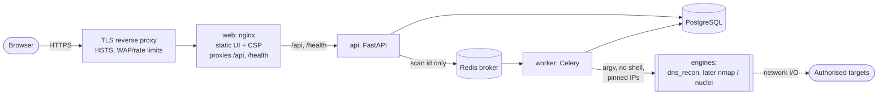
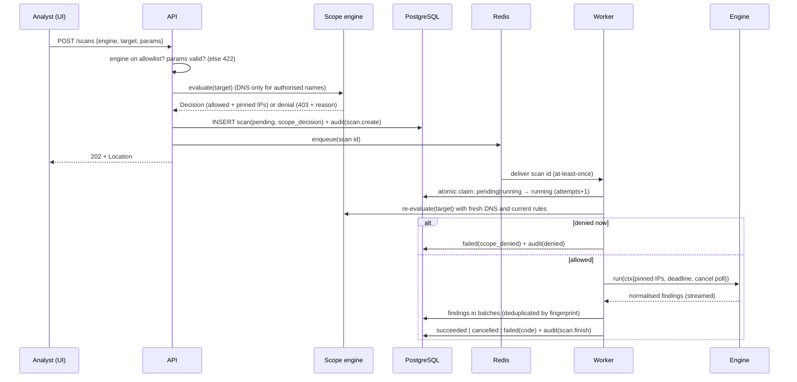
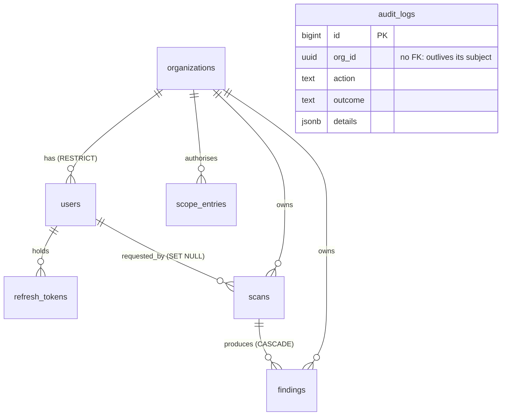

# Architecture

Decisions and their alternatives are in [`adr/`](adr/README.md); this page shows how the pieces
fit together.

## Components



One Python package (`neo_orchestro`), two processes from the same image (`api`, `worker`).

```
api ─► services ─► repositories ─► db (models)
          ├─► scope      pure policy; DNS resolver injected
          └─► engines    ports + adapters + safe process runner
orchestrator (Celery app, runner, worker entry point) ─► services, repositories, scope, engines
core         config, logging, errors, crypto primitives — imports nothing above it
```

Enforced by `backend/tests/unit/test_architecture.py`. Routers only parse → call a service →
serialise. Services own transactions (each use case commits itself) so audit rows of *denied*
actions survive the error that follows.

## Trust boundaries

| Boundary | Control |
|---|---|
| Internet → web | TLS proxy; nginx CSP, rate limit on `/api/v1/auth/` |
| Browser → API | Bearer access token (memory only) + HttpOnly SameSite=Strict refresh cookie + CSRF header |
| API → PostgreSQL | Org-scoped repositories; DB constraints; append-only audit triggers |
| API → Redis → worker | JSON only; **only the scan id** crosses the broker; target/params are read from PostgreSQL |
| Worker → tools | In-code engine allowlist; argv list, minimal env, limits, process-group kill |
| Worker → targets | Scope re-validated at execution; engines receive **pinned** IPs |

## Scan lifecycle



**State machine:** `pending → running → succeeded | failed | cancelled`.
A queued scan is cancelled by a conditional SQL transition; a running one gets
`cancel_requested_at` and stops at its next `ctx.check()`. After a worker crash the broker
redelivers; the claim re-enters `running` (up to 3 attempts) and de-duplication makes the rerun
idempotent.

## Data model



`audit_logs` rejects `UPDATE`, `DELETE` and `TRUNCATE` (trigger, migration `0001`).
`findings` are unique per `(scan_id, fingerprint)`; the fingerprint hashes
`[category, asset, title, key]` (ADR 0008).

## Error model and observability

- One error envelope with a stable `code` and the request id; validation errors never echo
  submitted values; unexpected errors are logged with a traceback but returned generically.
- Structured logs (structlog; JSON in Compose) with `request_id`; sensitive keys are redacted.
- `/health/live`, `/health/ready` (database + Redis), `/metrics`
  (`neo_http_requests_total{method,route,status}` with route *templates*, never raw paths).

## Adding an engine

1. Implement `Engine` (`engines/base.py`): `name`, `description`, `target_kinds`,
   `validate_params`, `run(ctx)` yielding `NormalisedFinding`. Call `ctx.check()` often.
2. External tool? Use `run_command(argv, …)` only; pass `ctx.pinned_ips`, not the host name, if
   the tool connects to the target. Map its native severities to the five-level scale.
3. Register it in `default_registry` (`engines/registry.py`) — deliberately, in code.
4. Tests: unit (parameters, mapping, cancellation), an injection/threat table, and an
   integration test through the runner. Check the licence (GPL tools are executed, never imported)
   and record it in `docs/licences.md`; write an ADR if the engine needs new capabilities.
